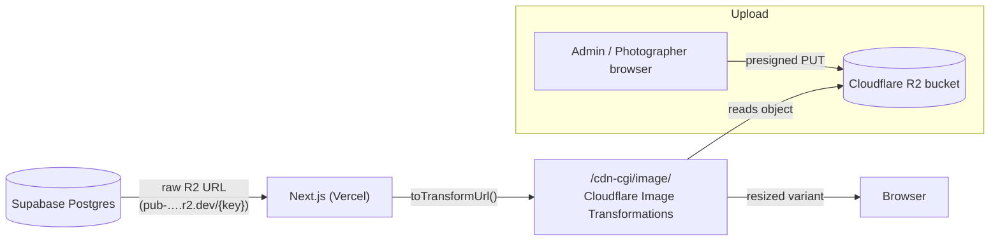
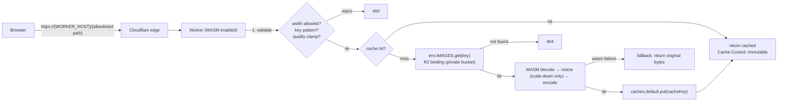

# PhotoBlinks Image Delivery — Target Architecture

> **Plan phase:** 2 of 7 (documentation only). This file records the *target*
> architecture for replacing Cloudflare Image Transformations with a
> self-managed Worker + WASM pipeline. It is a design artifact, not code.
>
> Companion file: [`migration-checklist.md`](./migration-checklist.md).

## Legend — evidence classes

- **VERIFIED** — confirmed against this repository or an authoritative source (documented inline).
- **ASSUMPTION** — believed true but not yet proven; must be validated before it gates a decision.
- **UNRESOLVED** — open decision; no value may be treated as final.

---

## 1. Current image flow (as-is) — VERIFIED



**Facts (all VERIFIED in this repo):**

1. Storage and transformation are already separated. Supabase stores **raw R2
   URLs** (`${R2_PUBLIC_URL}/{key}`, see `src/lib/r2/upload.ts:43`); the
   database never contains a transform URL.
2. There is exactly **one** producer of transform URLs:
   `toTransformUrl()` in `src/lib/cf-image-loader.ts` (the
   `/cdn-cgi/image/` string lives only at `cf-image-loader.ts:42`).
3. All transform URLs are render-time derived via four functions in two files:
   - `toTransformUrl()` — `src/lib/cf-image-loader.ts:48`
   - `adminPreviewUrl()` (width 400) — `src/lib/cf-image-loader.ts:75`
   - `cfImageLoader` (Next `loaderFile` default export) — `src/lib/cf-image-loader.ts:79`
   - `socialImageUrl()` (width 1200) — `src/lib/jsonld.ts:16`
4. `next.config.ts` sets `images.loader: "custom"` +
   `loaderFile: "./src/lib/cf-image-loader.ts"`, with `remotePatterns` for the
   R2 dev host and `images.photoblinks.com`.

**Known failure (VERIFIED, observed):** Cloudflare Image Transformations is
exhausted on the account. Requests return `HTTP 429` with body
`ERROR 9422: Free unique transformations by account has been exhausted`
(`cf-resized: err=9422`). Empirically, an (object, width) pair generated this
month serves `200`; any **new** pair returns `429`. Production already
requests a 10-width `srcset` per gallery image (distinct widths
`256,384,640,750,828,1080,1200,1920,2048,3840`), which is what drained the
quota. The fixed-width change already applied (uncommitted, see checklist §1)
reduces this to 2 widths per gallery page (`640,1200`).

---

## 2. Target Worker flow (proposed)



**Design decisions (each marked):**

| Decision | Choice | Status |
|---|---|---|
| R2 access | **R2 bucket binding** (`env.IMAGES.get`), bucket kept private | VERIFIED-feasible (CF R2 + Workers binding is standard); exact binding name UNRESOLVED |
| Request host | a new Workers route on a dedicated host (e.g. `img.photoblinks.com`) | UNRESOLVED — `img.photoblinks.com` is a *proposal*, not a configured value |
| Path scheme | own path, e.g. `/w/{width}/{format}/{quality}/{key}` | UNRESOLVED (must NOT be `/cdn-cgi/*` — see §4) |
| Cache | **Cache API** (`caches.default`) | VERIFIED (Workers standard) |
| Format negotiation | resolved into the cache key; no `Vary: Accept` | design decision (see §5) |
| Processing library | WASM library | UNRESOLVED — see §6 (no library approved) |
| Upscaling | **disabled** (scale-down only) | design decision |

---

## 3. Cache keys, widths, validation, errors

### Cache key (design)

```
https://{WORKER_HOST}/__transform/v{TRANSFORM_VERSION}/{width}/{format}/{quality}/{key}
```

- `TRANSFORM_VERSION` is a constant bumped on any encoder/resizer change, so
  old cached variants are never served under new logic.
- `format` is a concrete value (e.g. `webp`, `avif`, `jpeg`), never `auto`, so
  the key is deterministic and there is no `Vary: Accept` cache-collapse risk.
- `{key}` is the R2 object key verbatim.

### Width allowlist — fixed at the Worker (design)

| Width | Source (VERIFIED in repo) | Status |
|---|---|---|
| 160 | `DASHBOARD_THUMBNAIL_WIDTH`, `MAP_POPUP_IMAGE_WIDTH` | implemented (uncommitted + existing) |
| 400 | `ADMIN_PREVIEW_WIDTH` | existing |
| 640 | `GALLERY_SUPPORTING_IMAGE_WIDTH`, `CARD_IMAGE_WIDTH` | implemented |
| 800 | `PHOTOGRAPHER_PHOTO_WIDTH` | implemented (uncommitted) |
| 1200 | `GALLERY_PRIMARY_IMAGE_WIDTH`, `SOCIAL_IMAGE_WIDTH` | implemented |
| 1920 | `LIGHTBOX_IMAGE_WIDTH` | implemented (uncommitted) |

Anything not in the allowlist → `400`. **UNRESOLVED:** Group A sites (implicit
`srcset` loaders) still need fixed widths chosen; the checklist §2 lists them
but assigns no widths yet.

### Validation (all before any R2 read)

- Key regex restricted to real prefixes
  `locations|studios|categories|countries|states|cities|site|photographers|blog`;
  reject `..`, `\`, percent-encoded traversal, absolute URLs, and keys
  > 1024 bytes (R2 key limit — VERIFIED).
- Extension allowlist `jpg|jpeg|png|webp` (matches
  `ALLOWED_IMAGE_CONTENT_TYPES`, `src/lib/r2/upload.ts:9` — VERIFIED).
- Quality clamped 40–90.
- No arbitrary filter/parameter passthrough (this is what must never regress:
  the current exhaustion was caused by unbounded width variation).

### Error handling (design)

- Bad params → `400`.
- Missing object → `404`.
- WASM/processing failure → **serve the original object bytes** (graceful
  degradation), never a synthetic error image.
- Only `200` responses are cached; errors carry explicit short
  `Cache-Control`, so a failure can never be edge-cached (the current 429s
  were served with `CF-Cache-Status: HIT/EXPIRED` — observed).

### Rollback (design)

- `toTransformUrl()` switches output scheme behind one env flag
  (e.g. `NEXT_PUBLIC_IMAGE_PIPELINE=worker|cgi`). **UNRESOLVED:** exact flag
  name.
- Cloudflare Image Transformations stays enabled on the zone until the app
  no longer emits `/cdn-cgi/image/`, so the flag is a true revert lever.
- Rollback = flip the flag; no DB change, no URL migration.

---

## 4. Constraint: `/cdn-cgi/*` is reserved (ASSUMPTION)

The Worker must serve under a path the application owns, never under
`/cdn-cgi/`. Cloudflare reserves `/cdn-cgi/` paths on zones. **ASSUMPTION**
— not re-verified this session for the current Workers/routes model; treat as
a hard constraint until confirmed in Phase 3, and design to avoid it regardless.

---

## 5. Workers platform limits (VERIFIED — Cloudflare docs)

| Constraint | Workers Free | Workers Paid |
|---|---|---|
| CPU per request | **10 ms** | 5 min (default 30 s) |
| Memory | 128 MB | 128 MB |
| Worker size | 64 MiB | 64 MiB |
| Startup | 1 s | 1 s |
| Requests | 100 k/day | unlimited |
| WASM | pre-compiled modules; SIMD yes; **threading NO**; WASI experimental | same |

**Implication:** image decode+resize of a multi-megabyte original cannot fit
the Free tier's 10 ms CPU budget. A paid tier is effectively required; the
exact tier is **UNRESOLVED**. 128 MB is the same on both tiers and is the
dominant memory ceiling (a 10 MP image needs ~40 MB for one RGBA buffer plus
WASM heap; `MAX_UPLOAD_BYTES` is 10 MB — VERIFIED `upload.ts:21`).

---

## 6. WASM library evaluation — no library approved

VERIFIED against the npm registry:

| Library | License / latest | Evidence |
|---|---|---|
| `wasm-image-optimization` | MIT / 2.0.11 | registry metadata: "Optimize images with wasm on edge runtime", keywords include `cloudflare`, `workers`, `WebAssembly` |
| `@cf-wasm/photon` | Apache-2.0 / 0.4.0 | registry metadata: "Photon library for Cloudflare workers" |

UNVERIFIED / still open:

- `@jsquash/*` (mozjpeg/png/webp/avif/resize) — npm registry returned 403;
  **unverified**; candidate only if AVIF encoding is required.
- `sharp`, `libvips-wasm`, `wasm-imagemagick` — ruled out by design (native
  deps / threading / FS requirements), not benchmarked.

**UNRESOLVED — must be settled by the Phase 3 benchmark spike:** per-image
CPU time, peak memory at each allowlisted width, AVIF support, exact WASM
bundle size, and cache-hit ratio. **No library is approved by this document.**

---

## 7. Security risks & mitigations

| Risk | Mitigation |
|---|---|
| Worker becomes an arbitrary transform/proxy endpoint (cost + quota DoS) | width allowlist, no filter params, quality clamp, rate-limit rule |
| Object enumeration through the Worker | strict key-pattern allowlist; no listing; uniform 404 |
| Pending (unapproved) photographer submissions reachable | keys are epoch/UUID and unpredictable; keep prefixes allowlisted; revisit if the invariant weakens |
| 128 MB exhaustion → Error 1102 | cap input dimensions, fall back to original, avoid duplicate buffers |
| WASM panic taking down the isolate | catch-all → serve original bytes |
| Error responses edge-cached | only `200` cached |
| `Vary: Accept` cache poisoning | format folded into cache key |
| Preview deployment runs production Supabase + service-role key | remove preview / isolate Preview env (see checklist §7) |

---

## 8. Open questions (explicitly UNRESOLVED)

1. Worker hostname and route pattern (proposal: `img.photoblinks.com`,
   path `/w/…` — **not configured anywhere**).
2. Workers plan/tier (paid required; which one).
3. WASM library choice — pending benchmark.
4. AVIF support (encode) yes/no.
5. Fixed widths for the Group A `srcset` sites.
6. Env-flag name for cutover/rollback.
7. `TRANSFORM_VERSION` initial value.
8. Rate-limit configuration values.
9. `/cdn-cgi/` reservation status on the current Workers/routes model.

## 9. Scope guard (VERIFIED decisions, not to be revisited lightly)

- **R2 remains the original-image store.** Nothing in the migration moves,
  re-keys, or re-buckets originals. (Eliminating Image Transformations does
  not eliminate the R2 dependency.)
- The `opengraph-image` default (`src/app/opengraph-image.tsx`, generated by
  `next/og`) is **not** part of this pipeline.
- No new database tables, columns, or migrations are required.
